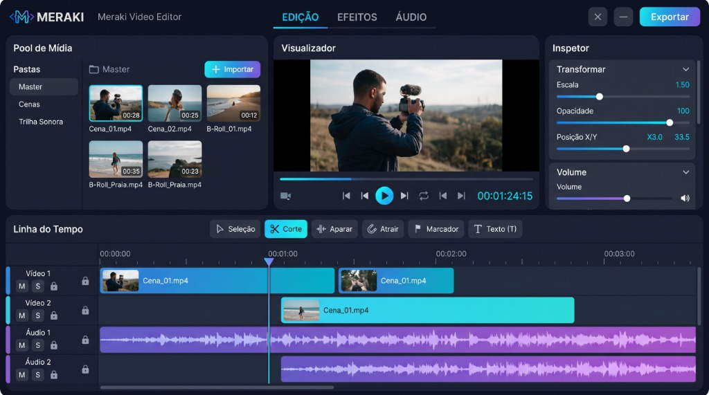
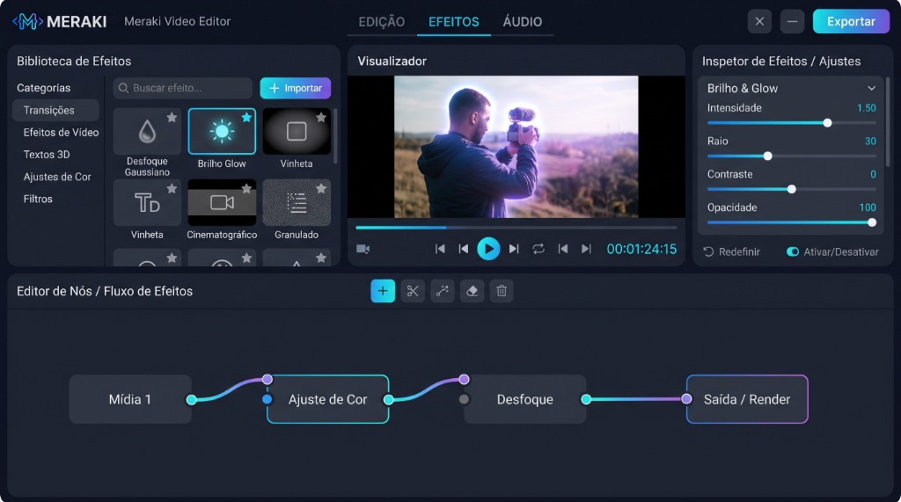
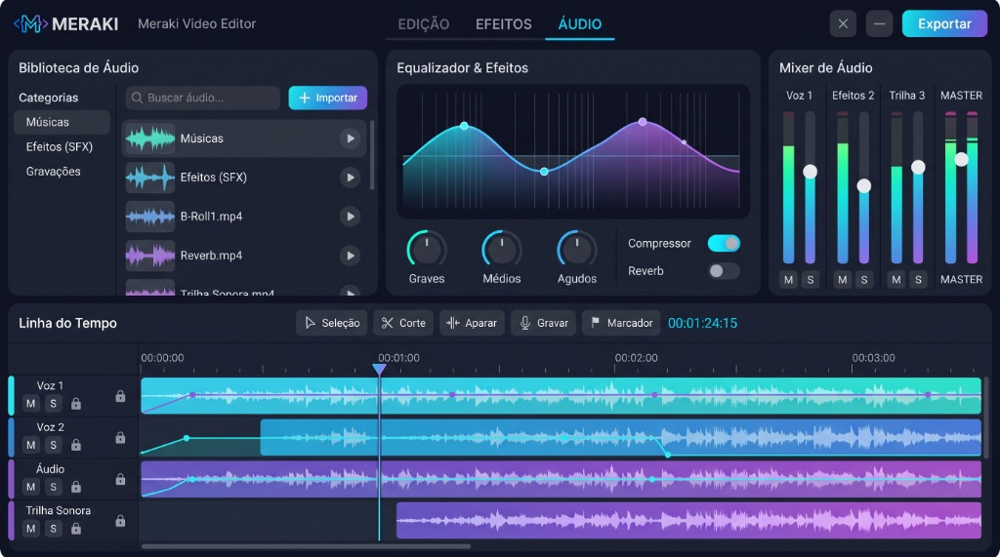

<p align="center"></p>

<h1 align="center">Meraki Video Editor</h1>
<p align="center"><strong>Precisão para sua linha do tempo. Espaço para suas ideias.</strong></p>
<p align="center">Montagem · Trama · Som · Entrega</p>

<p align="center">
  <a href="https://github.com/merakkicode/Meraki-Video-Editor/releases/tag/v1.0.0"></a>
  <a href="https://github.com/merakkicode/Meraki-Video-Editor/actions/workflows/ci.yml"></a>
  <a href="LICENSE"></a>
  
</p>

<p align="center"><strong>Português</strong> · <a href="docs/README.en.md">English</a></p>

Meraki é um editor de vídeo gratuito e de código aberto para Windows e Linux. Organize seus clipes, anime títulos, ajuste a imagem e o som e exporte o resultado em uma única aplicação. Desenvolvido e mantido pela **Equipe Meraki e Meraki Contributors**.

## Baixar o Meraki 1.0.0

**Escolha seu sistema. Os dois pacotes incluem os mesmos recursos do editor.**

| Sistema | Download oficial | Como instalar |
|---|---|---|
| **Windows 10/11 · x64** | **[Baixar Meraki-Setup.exe](https://github.com/merakkicode/Meraki-Video-Editor/releases/download/v1.0.0/Meraki-Setup.exe)** | Abra o instalador e siga as instruções. |
| **Linux · x64** | **[Baixar Meraki.AppImage](https://github.com/merakkicode/Meraki-Video-Editor/releases/download/v1.0.0/Meraki.AppImage)** | Permita executar o arquivo e abra o AppImage. |

Uma versão por sistema, sem edições pagas ou recursos separados por pacote. Não é necessário instalar Rust, Node.js ou FFmpeg para usar esses downloads.

[Notas da versão](https://github.com/merakkicode/Meraki-Video-Editor/releases/tag/v1.0.0) · [Guia de instalação](docs/installation.md) · [Primeiros passos](docs/getting-started.md) · [Relatar um problema](https://github.com/merakkicode/Meraki-Video-Editor/issues/new/choose)

No Linux:

```bash
chmod +x Meraki.AppImage
./Meraki.AppImage
```

O AppImage usa Ubuntu 22.04 como base de compilação e requer um ambiente gráfico e drivers compatíveis. Os pacotes ainda não têm assinatura digital; consulte o guia para verificar o SHA-256 e resolver problemas de abertura. ARM e macOS não fazem parte desta distribuição. Os arquivos de fontes e checksums da release são materiais adicionais para desenvolvedores, não outros instaladores.

## Do primeiro clipe à entrega

1. Abra **Montagem** e importe um vídeo para o **Acervo**.
2. Insira o vídeo na linha do tempo. Use **Espaço** para reproduzir e **Ctrl+B** para cortar.
3. Arraste as bordas para aparar; ative **Encaixe** com **N** e adicione marcadores com **M**.
4. Ajuste a imagem em **Trama** e os volumes em **Som**.
5. Salve seu projeto `.meraki`. Em **Entrega**, escolha o destino, adicione à fila e inicie o render.

Os projetos referenciam os arquivos originais: mantenha suas mídias junto do projeto ou use **Reconectar Mídia** quando mudarem de lugar.

## Quatro espaços, um projeto

| Espaço | O que você pode fazer |
|---|---|
| **Montagem** | Editar múltiplas trilhas, cortar, aparar, usar Ripple por trilha, encaixe e marcadores. Criar títulos, transições e animações com keyframes lineares ou Bézier. |
| **Trama** | Ajustar brilho, contraste, saturação e desfoque por nós; compor camadas com escala, posição, opacidade e Picture-in-Picture. |
| **Som** | Ouvir o áudio em tempo real, ajustar faders, Mute/Solo e saída principal, acompanhar medidores e aplicar equalização de graves, médios e agudos. |
| **Entrega** | Exportar pela fila de render com presets YouTube, vertical, Web e Master, ou personalizar H.264, H.265 e ProRes. |

Proxies de 720p deixam a prévia mais leve; a exportação utiliza os originais. O salvamento automático cria pontos de recuperação a cada três minutos. Na abertura seguinte, o Meraki oferece a recuperação disponível.

<details>
<summary><strong>Conheça a identidade visual</strong></summary>

Referências de design dos espaços criativos. A interface distribuída utiliza os nomes Montagem, Trama, Som e Entrega; controles e disposição podem diferir destas referências.





</details>

## Tecnologia e qualidade

Rust 2021 sustenta o modelo de tempo racional e as operações editoriais. Tauri v2 e SolidJS compõem a interface. O compositor usa wgpu/WGSL com alternativa em CPU; o áudio usa CPAL. Os frames chegam à prévia por um canal binário, sem imagens em JSON ou Base64.

O CI verifica testes, formatação, Clippy e frontend em Windows e Linux, gera os dois pacotes e testa os codecs de exportação. Testes de áudio físico e GPU têm execução específica; resultados e limitações estão em [Validação](docs/testing.md). Desempenho depende do dispositivo, dos codecs e do projeto.

Limites da versão inicial: composição em 8 bits, sem fluxo HDR; Ripple atua na trilha selecionada; o cache de proxies não possui cota automática. O autosave complementa o salvamento manual e não substitui backup.

## Para desenvolver e contribuir

Consulte [Compilar a partir do código-fonte](docs/building.md), [Arquitetura](docs/architecture.md) e [Contribuir](CONTRIBUTING.md). A estrutura inclui crates independentes para domínio, timeline, grafos, motor, mídia, áudio, composição, persistência, render e desktop.

Encontrou um defeito ou tem uma proposta? Abra uma [issue](https://github.com/merakkicode/Meraki-Video-Editor/issues/new/choose), descreva seu sistema e forneça passos que permitam reproduzir o caso. A comunidade segue o [Código de Conduta](CODE_OF_CONDUCT.md).

## Licença

O código original do Meraki está disponível sob a licença [Apache-2.0](LICENSE). FFmpeg, codecs, fontes e demais dependências conservam suas próprias licenças e créditos. Consulte [Componentes de terceiros](THIRD_PARTY_NOTICES.md); os materiais de distribuição acompanham a release.

**Meraki Core Team · Meraki Contributors**
