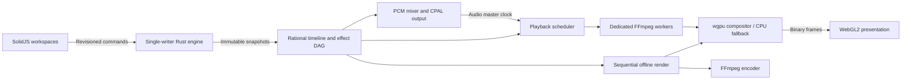

# Architecture

Meraki Core Team separates editorial state, playback and pixel processing. The timeline contains metadata and canonical rational time; decoded frames belong to bounded caches and rendering workers.

Commands check the expected revision and validate a candidate timeline before publication. Undo is bounded to 64 states and revisions remain monotonic. Time and IDs cross the JavaScript boundary as decimal strings. Intervals are half-open. Trims account for playback speed and available source handles; Ripple affects the edited track only.

The audio callback consumes preallocated SPSC data without disk access, allocation or blocking mutexes. Background workers decode, resample, mix and apply biquad EQ. Video follows the audio clock during playback. Seek generations discard stale preview results; offline export never drops frames.

The compositor shares transforms, premultiplied-alpha blending, color correction, separable blur, titles and animation between preview and export. GPU upload/readback and binary WebGL2 delivery still involve copies. This is not a zero-copy pipeline. GPU initialization failure selects the Rayon CPU fallback.

Proxies replace only preview decoder inputs. Export and audio retain original media references. Autosave stores validated project checkpoints every 180 seconds. Relink preserves editorial timing but resets Undo. The project schema is 3, with migration from schemas 1 and 2.

Windows uses DirectX 12/Vulkan and WASAPI. Linux targets Vulkan and CPAL's ALSA backend; the default ALSA device can route through PipeWire/PulseAudio compatibility plugins. Flatpak supplies an ALSA-to-PulseAudio configuration. Installed system fonts are used on Windows; Linux maps the available title families to DejaVu Sans/Serif, so text metrics may differ across platforms.
